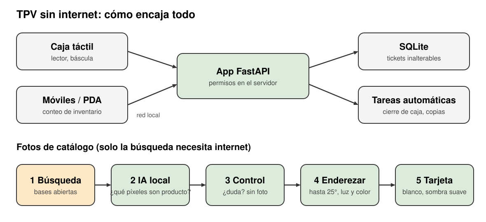

[English](README.md) · **Español**

# TPV sin internet para una tienda pequeña, con IA local para las fotos del catálogo

Caso de estudio de un punto de venta (TPV) que hice para una tienda de barrio. El código completo es privado porque es de un negocio real. Este repo enseña el problema, las decisiones y lo que más me gusta: cómo un modelo de IA local convierte fotos de producto en fotos de catálogo limpias, en un PC modesto y sin que ninguna foto salga de la tienda.

## El problema

- La tienda no tenía un programa para sus productos, su stock ni su cierre de caja diario.
- El equipo es un PC táctil de poca potencia con lector de códigos de barras y báscula.
- Quien está en la caja no es técnico, y la conexión no siempre está.
- Los tickets de venta tienen que ser fiables: no se pueden editar y los datos deben poder pasarse después a un sistema certificado. No es software fiscal certificado ni pretende serlo.

## Qué hace

Vender con lector y báscula, llevar el stock, apuntar las compras a proveedores, cerrar la caja cada día, sacar informes y un paquete para la gestoría. Varias personas pueden contar el inventario a la vez desde el móvil.

## Hecho a la medida de cómo funciona la tienda

Partí del día a día de la tienda, no de una lista de funciones, y el diseño lo sigue.

| Cómo es la tienda | Qué construí |
|---|---|
| Vende alimentación y también servicios, con productos a granel por peso y códigos internos propios | Una caja que lee las etiquetas de la báscula y los códigos internos junto a los códigos de barras normales, y una forma aparte de cobrar servicios |
| Quien está en la caja no es técnico y el PC es modesto | Pantallas pensadas para el dedo, un PIN por persona, nada que recordar. La IA usa un solo núcleo y se aparta cuando se está vendiendo |
| La conexión va y viene | Todo funciona sin internet. La búsqueda de fotos simplemente reintenta más tarde |
| Los registros de venta tienen que ser fiables y puede que la tienda necesite después un programa certificado | Requisitos de diseño, no una declaración de cumplimiento: los tickets no se editan ni se borran, las correcciones son tickets nuevos y los datos se mantienen limpios y exportables para que pasar a uno certificado no sea empezar de cero |
| Los precios cambian y la estantería tiene que coincidir | Etiquetas con el formato y tamaño correctos, precio por kg, litro o unidad, ofertas con fechas y una cola que avisa de qué etiquetas están desactualizadas tras un cambio de precio |
| Nadie se acuerda de las tareas aburridas | Cierre de caja diario automático, copias al arrancar, prueba semanal de restauración y un paquete para la gestoría |
| Cientos de productos y ninguna foto de catálogo | El proceso de fotos de arriba, que además respeta las licencias: solo bases abiertas, fuente apuntada por producto y nunca imágenes de Google |

El plan del proyecto incluye validarlo antes de fiarse de él: una semana de prueba en la que cada cierre de caja se contrasta con los registros propios de la tienda, y un recuento de 20 productos al empezar y al acabar esa semana. Es trabajo planificado, no un resultado.

## La IA de las fotos

Con cientos de productos, hacer cada foto a mano no es realista. Así que el sistema las fabrica.

1. **Búsqueda (el único paso que necesita internet).** Se busca el código de barras en bases de datos abiertas y gratuitas (Open Food Facts y sus proyectos hermanos). Solo se bajan fotos de esos dominios, nunca se sustituye una foto que ya existe y si no hay se reintenta al mes.
2. **IA local.** Un modelo de segmentación (U²-Net, Apache 2.0) funciona en el propio PC de la tienda con ONNX Runtime y responde a una sola pregunta: ¿qué píxeles son el producto? Usa un solo núcleo para que la caja siga fluida, se carga solo cuando hace falta y se libera de la memoria si no se usa. Se descarga una vez y se comprueba con una huella SHA-256 fija.
3. **Limpieza y control de calidad.** Se quitan las manchas sueltas (una balda, una mano). Si la máscara está vacía, lo cubre todo o el modelo duda de dónde acaba el producto, la foto no se usa. Mejor sin foto que con una mala.
4. **Enderezar y corregir.** El producto se gira hasta quedar recto (hasta 25 grados) buscando el giro con la caja envolvente más pequeña. La luz y el color se corrigen midiendo solo el producto, con el mismo ajuste en los tres canales para que un rojo siga siendo rojo.
5. **Tarjeta de catálogo.** El producto, centrado sobre blanco, con aire alrededor y una sombra suave.
6. **La mejor de varias.** Si un producto tiene varias fotos, cada una recibe una nota por tamaño, nitidez y limpieza del recorte, y gana la mejor.

La IA es un paso pequeño y reemplazable. El resto es código normal que se puede probar sin el modelo: una versión de pruebas ocupa su lugar. [`samples/photo_pipeline.py`](samples/photo_pipeline.py) muestra el control de calidad, el enderezado y el punto de entrada. Es un fragmento, no un módulo ejecutable (las funciones auxiliares que llama están en el código privado): la lógica es la del proyecto, con los comentarios traducidos al inglés.

## Decisiones que lo definieron

| Decisión | Por qué |
|---|---|
| FastAPI + SQLite, en el PC de la tienda | Funciona con poca potencia y sin internet. Un solo archivo para la copia. |
| Funciona sin internet; la red solo se usa para copias y para buscar fotos | Que se caiga la conexión nunca debe parar una venta. |
| Las fotos se procesan en local | Ninguna foto sale de la tienda. |
| Permisos comprobados en el servidor, en una tabla explícita ruta a ruta | Ocultar un botón no protege nada. Una prueba falla si una ruta nueva no tiene nivel de permiso. |
| Tres roles (caja, encargado, administrador) con PIN; quien tiene más permisos puede autorizar en el momento | Encaja con cómo funciona una tienda pequeña. |
| Los tickets no se pueden borrar ni editar, y la base de datos lo impone con disparadores | Los registros de venta siguen siendo fiables. Una devolución crea un ticket rectificativo. |
| La lógica de cálculo está separada de la web y de la base de datos | Se puede probar sin arrancar la aplicación. |
| Contar el inventario no cambia el stock; se revisa y se aplica al final | Se puede seguir vendiendo mientras se cuenta. |
| Cierre de caja diario automático y copias al arrancar (se guardan las últimas 30) | Lo que nadie se acuerda de hacer. |

## Calidad y seguridad

Cada push ejecuta las pruebas unitarias y de API, pruebas de navegador con Playwright y comprobaciones de seguridad (bandit y pip-audit) en CI.

## Cómo se hizo

Desarrollado con Claude Code, con un pequeño equipo de subagentes especialistas que definí en el proyecto para diagnóstico de incidencias, pruebas de navegador, revisión de seguridad, rendimiento, revisión de código y dudas fiscales. El flujo de trabajo está documentado en la propia documentación del proyecto (repo privado).

## Stack

Python 3.13 · FastAPI · SQLite · ONNX Runtime · U²-Net · Pillow y NumPy · Playwright · GitHub Actions
