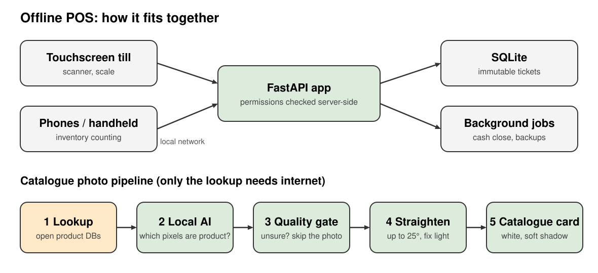

**English** · [Español](README.es.md)

# Offline point-of-sale for a small shop, with an on-device AI photo pipeline

A case study of a point-of-sale (POS) system I built for a small neighbourhood shop. The full source is private because it belongs to a real business. This repo shows the problem, the decisions, and the part I find most interesting: how a local AI model turns product photos into clean catalogue photos, on a weak PC, with no photo leaving the shop.

## The problem

- The shop had no program for its products, stock or daily cash close.
- The hardware is a low-power touchscreen PC with a barcode scanner and a scale.
- The people at the till are not technical, and the connection is not always there.
- Sales tickets have to stay trustworthy: they can't be edited, and the data has to be easy to move to a certified system later. This is not certified fiscal software and does not claim to be.

## What it does

Sell with scanner and scale, track stock, record supplier purchases, close the cash each day, produce reports and a package for the accountant. Several people can count inventory at the same time from their phones.

## Built around how the shop works

I started from the shop's day, not from a feature list, and the design follows it.

| What the shop is like | What I built |
|---|---|
| It sells groceries and also services, with loose items by weight and its own internal codes | A till that reads scale labels and internal codes next to normal barcodes, and a separate way to ring up services |
| People at the till are not technical, and the PC is weak | Touch-first screens, one PIN per person, nothing to remember. The AI runs on one core and gets out of the way when a sale is happening |
| The connection comes and goes | Everything works offline. Photo lookup simply retries later |
| Sales records have to be reliable, and the shop may later need certified software | Design constraints, not a compliance claim: tickets can't be edited or deleted, corrections are new tickets, and the data stays clean and exportable so a move to a certified system doesn't start from zero |
| Prices change, and the shelf has to match | Labels in the right format and size, price per kg, litre or unit, offers with dates, and a queue that tells you which labels are out of date after a price change |
| Nobody remembers the boring jobs | Automatic daily cash close, backups on start, a weekly restore test, a package for the accountant |
| Hundreds of products, no catalogue photos | The photo pipeline above, which also respects licences: only open databases, source recorded per product, never Google images |

The project plan includes a validation step before relying on it: a trial week where each cash close is checked against the shop's own records, and a stock count of 20 products at the start and end of that week. This is planned work, not a result.

## The AI photo pipeline

With hundreds of products, shooting every photo by hand is not realistic. So the system builds them.

1. **Lookup (the only step that needs internet).** The barcode is searched in free, open product databases (Open Food Facts and its sister projects). Only photos from those domains are downloaded, an existing photo is never replaced, and a miss is retried a month later.
2. **Local AI.** A segmentation model (U²-Net, Apache 2.0) runs on the shop PC with ONNX Runtime and answers one question: which pixels are the product? It runs on a single core so the till stays fluid, loads only when needed, and is released from memory when idle. It is downloaded once and checked against a fixed SHA-256 hash.
3. **Cleanup and quality gate.** Stray blobs (a shelf, a hand) are removed. If the mask is empty, covers everything, or the model is unsure where the product ends, the photo is not used. No photo is better than a bad one.
4. **Straighten and correct.** The product is rotated upright (up to 25 degrees) by finding the rotation with the smallest bounding box. Brightness and colour are corrected by measuring the product only, with the same adjustment on all channels so a red stays red.
5. **Catalogue card.** The product is centred on white with room around it and a soft shadow.
6. **Best of several.** When a product has several photos, each one is scored on size, sharpness and how cleanly it was cut out, and the best one wins.

The AI is one small, replaceable step. The rest is plain code that can be unit-tested without the model: a test double stands in for it. [`samples/photo_pipeline.py`](samples/photo_pipeline.py) shows the quality gate, the straightening and the pipeline entry point. It is an excerpt, not a runnable module (helpers it calls are in the private code): the code logic is as in the project, with comments translated to English.

## Decisions that shaped it

| Decision | Why |
|---|---|
| FastAPI + SQLite, runs on the shop PC | Works on weak hardware and with no internet. One file to back up. |
| Works offline; the network is used only for backups and catalogue-photo lookup | A dropped connection must never stop a sale. |
| Photos are processed locally | No photo leaves the shop. |
| Permissions checked on the server, in an explicit route-by-route table | Hiding a button protects nothing. A test fails if a new route has no permission level. |
| Three roles (till, manager, admin) with PINs; someone with more rights can approve in the moment | Fits how a small shop actually works. |
| Tickets can't be deleted or edited, enforced in the database with triggers | Sales records stay trustworthy. A refund creates a corrective ticket instead. |
| Calculation logic kept separate from the web and database layers | It can be unit-tested without starting the app. |
| Inventory counting doesn't change stock; it is reviewed first and applied at the end | Selling can continue during a count. |
| Automatic daily cash close and backups on start (last 30 kept) | The things nobody remembers to do. |

## Quality and safety

Every push runs the unit and API tests, browser tests with Playwright, and security checks (bandit and pip-audit) in CI.

## How it was built

Developed with Claude Code, using a small set of specialist sub-agents that I defined in the project for incident diagnosis, browser testing, security review, performance, code review and tax questions. The workflow is documented in the project's own docs (private repo).

## Stack

Python 3.13 · FastAPI · SQLite · ONNX Runtime · U²-Net · Pillow and NumPy · Playwright · GitHub Actions
